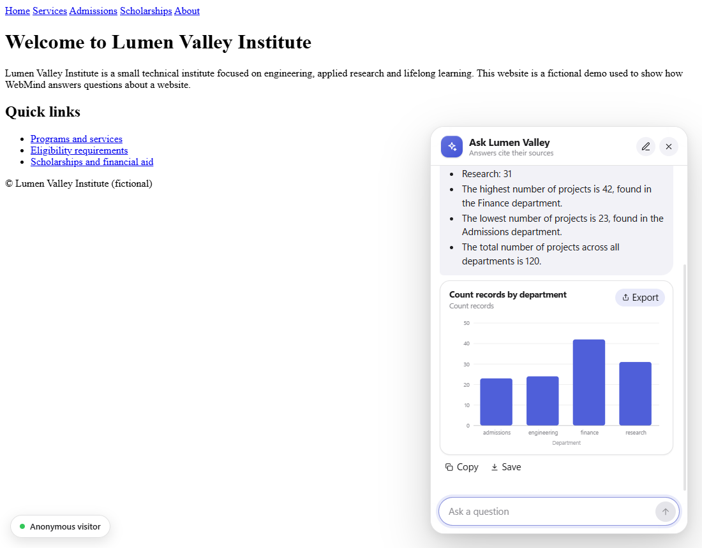
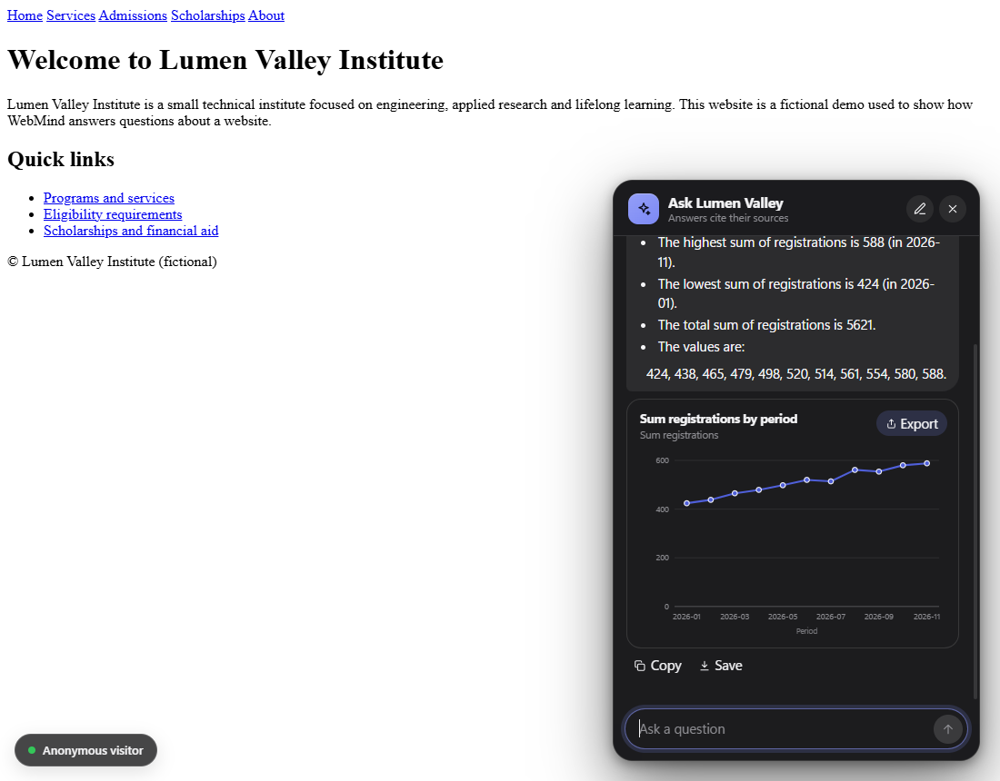
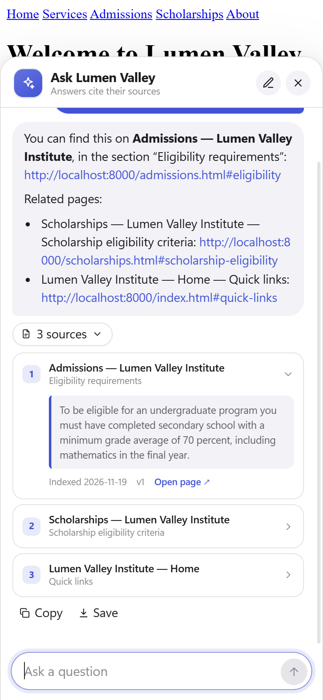
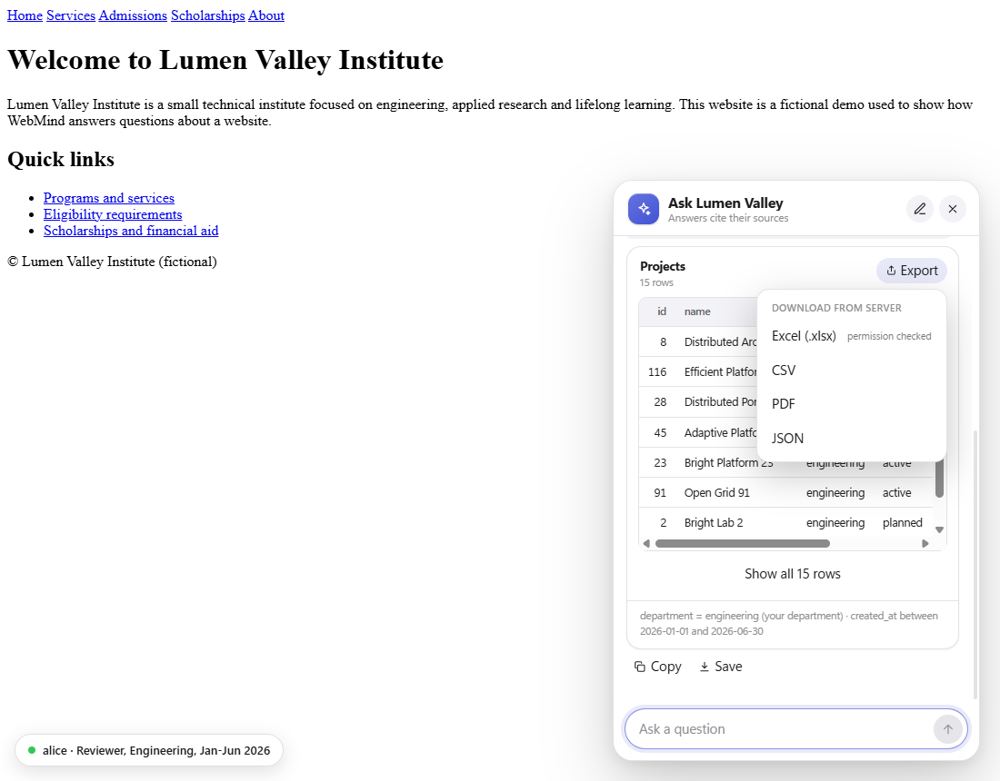

<div align="center">

# WebMind

**Add a permission-aware AI assistant to your website, dashboard or application, using your own LLM, your own data, and your own login system.**

[](LICENSE)
[](pyproject.toml)
[](docs/status.md)
[](docs/deployment.md)

<table>
  <tr>
    <td></td>
    <td></td>
    <td></td>
  </tr>
  <tr>
    <td align="center"><sub>Charts, tables and cited answers inside the conversation</sub></td>
    <td align="center"><sub>Light and dark, follows the system</sub></td>
    <td align="center"><sub>Phone bottom sheet</sub></td>
  </tr>
</table>

</div>

> **Status: alpha (0.1.0).** The core is implemented and tested, but WebMind is not yet published to PyPI or npm and has
> not had a production hardening pass. Read [What works and what doesn't](#maturity-and-limitations) before relying on it.

## What is WebMind?

WebMind is **integration-first, self-hostable assistant infrastructure**. You run a small WebMind server next to your
application, point it at your content and databases, give it a language model, and embed a chat interface in your
site. The assistant then answers questions, finds the right page, retrieves records, draws charts and prepares exports,
**but only with what the signed-in user is allowed to see.**

You integrate it with an SDK, a configuration file and a little glue code. You do not fork or modify WebMind.

## Why it exists

Adding "chat with our data" to a real product usually means building retrieval, sync, text-to-SQL safety, charting,
exports and, hardest of all, authorization, from scratch, then discovering that the model can be talked into showing the
wrong rows. WebMind packages that infrastructure with one rule at its centre: **your application owns authentication,
WebMind enforces authorization before any data reaches a model.**

## Who it's for

| You are | You get |
| --- | --- |
| A team with a **public website or docs site** | A cited, navigation-aware assistant that only knows your published pages |
| A team with a **dashboard or internal app** | Natural-language records, statistics, charts and exports that respect roles, departments and date windows |
| A team with **privacy or sovereignty constraints** | Everything on your infrastructure; a local LLM (Ollama) or any endpoint you choose |
| A developer who wants to **evaluate or extend** | A modular Python codebase, typed config, tests and documented limits |

## How it works

```
 Your application                         WebMind server (self-hosted)                    Your systems
┌─────────────────────┐   signed token   ┌──────────────────────────────────────┐
│ login, sessions,    │ ───────────────▶ │ 1. verify identity (JWT)              │      ┌─ website / documents
│ users, roles        │                  │ 2. policy engine: capabilities, ACLs, │ ◀────┤  (crawled or files, read-only)
│                     │                  │    fields, rows, dates, tenants       │      ├─ SQL databases (read-only)
│ <WebMindFloating/>  │ ◀─ answer, ───── │ 3. retrieval + validated analytics    │      └─ your LLM (Ollama / OpenAI-
│ or <script> widget  │    citations,    │ 4. grounded answer, chart, export     │         compatible / Claude)
└─────────────────────┘    charts, files │ 5. audit log                          │
                                         └──────────────────────────────────────┘
```

- **The LLM never decides access.** Permissions are computed first by a deterministic policy engine; restricted text
  never reaches the model, and a model-proposed plan cannot add capabilities.
- **No model-written SQL.** The model chooses fields; WebMind compiles a validated, parameterized read-only `SELECT`
  over the columns you listed, with mandatory tenant, row and date filters, timeouts and row limits.
- **Read-only by construction.** Connectors and dataset connections cannot modify your sources.
- **Auditable.** Every allow or deny for a tool call is logged with the user, reason, row count and the SQL that ran.

Details: [ARCHITECTURE.md](ARCHITECTURE.md), [docs/security/README.md](docs/security/README.md).

## Quick start: integrate WebMind into your product

The workflow is *install, configure, integrate*. Steps 4 to 6 are configuration of your WebMind server
(`webmind.yaml`); the code you write is small.

### 1. Install the SDK

WebMind is not on PyPI or npm yet; install from a checkout of this repository.

```bash
git clone https://github.com/kowshikramtg/WebMind.git

# WebMind server + in-process Python SDK (add the extras you need)
pip install "./WebMind[pdf,xlsx,reports]"          # also: postgres, mysql, anthropic, docx, rsa, numpy, ...

# Python client + token helper for YOUR backend (tiny: httpx + pyjwt)
pip install ./WebMind/sdk/python

# React components (build a package file once, install it in your app)
cd WebMind/sdk/react && npm install && npm run build && npm pack      # -> webmind-react-0.1.0.tgz
cd /path/to/your-app && npm install /path/to/WebMind/sdk/react/webmind-react-0.1.0.tgz
```

Requirements: Python 3.10+; Node 18+ for the React SDK. The script widget needs no Node at all.

### 2. Initialize WebMind

```bash
mkdir my-assistant && cd my-assistant
webmind init . --source https://www.example.org --llm ollama --auth host_application
```

This writes `webmind.yaml` (the configuration you will edit below) and a git-ignored `.env` containing generated
secrets (`WEBMIND_JWT_SECRET`, `WEBMIND_ADMIN_API_KEY`). `--source` accepts a website URL or a local folder.

### 3. Configure the endpoint

Run the server and note its address. Your pages and backend talk to it; the browser never holds a secret.

```bash
webmind serve                     # http://127.0.0.1:8080  (interactive API docs at /docs)
```

Production: put it behind your TLS reverse proxy and list your site in `server.cors_origins`, or proxy it under your own
domain (for example `/webmind-api`) so no CORS is needed. See [docs/deployment.md](docs/deployment.md).

### 4. Connect your data sources and database

Everything is declared in `webmind.yaml`. Secrets use `${ENV_VAR}` and never live in the file.

```yaml
# webmind.yaml
sources:                                    # unstructured content: pages, documents
  - id: website
    type: website                           # crawls sitemap + links on this host (robots.txt respected)
    url: https://www.example.org
    access: { visibility: public }
    path_rules:                             # first match wins
      - pattern: "/staff/"
        access: { visibility: restricted, roles: [employee, admin] }
  - id: handbooks
    type: filesystem                        # HTML, Markdown, TXT, PDF, DOCX
    path: ./content/handbooks
    base_url: https://intranet.example.org/handbooks
    access: { visibility: restricted, roles: [employee] }

datasets:                                   # structured data, queried live, read-only
  - id: projects
    description: Projects with department, status, creation date and budget
    connection: ${ANALYTICS_DB_URL}         # SQLite, PostgreSQL or MySQL; use a read-only DB role
    table: projects
    date_column: created_at
    columns:
      - { name: department, type: string, groupable: true }
      - { name: status, type: string, groupable: true }
      - { name: created_at, type: date }
      - name: budget
        type: number
        aggregatable: true
        access: { visibility: restricted, roles: [employee, admin] }   # field-level policy
    access: { visibility: public }          # public aggregates; raw rows need records:read
    row_filters:
      - { column: department, equals_attribute: department, unless_roles: [admin], applies_to: protected_fields }
    max_rows: 1000
```

Only listed columns are ever queried. Index your sources with `webmind index`; later changes sync incrementally
(`webmind sync`, a scheduler, or a signed webhook).

### 5. Configure the LLM and storage

```yaml
llm:
  provider: ollama                  # none | ollama | openai (any OpenAI-compatible endpoint) | anthropic
  model: llama3.1
  base_url: http://localhost:11434
  # api_key: ${WEBMIND_LLM_API_KEY}   # for hosted providers

embeddings:
  provider: ollama                  # hashing (built-in, lexical) | ollama | openai | sentence_transformers
  model: nomic-embed-text
  base_url: http://localhost:11434

database:                           # WebMind's own metadata + keyword index
  url: ${WEBMIND_DATABASE_URL:-sqlite:///./data/webmind.db}     # or postgresql+psycopg://...
vector_store:
  provider: database                # exact search in the metadata DB; `pgvector` for PostgreSQL
object_store:
  provider: local                   # originals, normalized text and expiring exports
  path: ./data/objects
```

`llm.provider: none` is valid: answers are then cited extracts of your content, with no model needed. See
[docs/configuration.md](docs/configuration.md) for every option.

### 6. Supply identity and authorization

Your application keeps its login system. After it authenticates a user it signs a **short-lived token** describing them;
WebMind verifies it and decides what that user may see. Roles map to capabilities; attributes drive row and field rules.

```yaml
security:
  authentication:
    mode: host_application          # or `public` for anonymous-only sites
    allow_anonymous: true           # visitors without a token get the `public` role
    jwt:
      algorithms: [HS256]           # RS256/ES256 with a public_key are supported too
      secret: ${WEBMIND_JWT_SECRET} # >= 32 characters
  roles:
    public:   { capabilities: [chat, search, navigate, "documents:read", analytics] }
    employee: { inherits: [public], capabilities: ["records:read"] }
    admin:    { inherits: [employee], capabilities: [export, reports, "sync:status"] }
```

Capabilities are `chat`, `search`, `navigate`, `documents:read`, `records:read` (raw rows), `analytics` (aggregates and
charts), `export`, `reports` and `sync:status`. A request must pass the **capability, dataset, field, row and date**
layers; anonymous callers can never read raw rows or export unless you grant it. Sign the token in your backend:

```python
# your backend, after YOUR application has authenticated the user
import os
from webmind_client import sign_user_token

token = sign_user_token(
    os.environ["WEBMIND_JWT_SECRET"],                 # same secret as security.authentication.jwt.secret
    user_id=str(user.id),
    roles=["employee"],                               # names from security.roles
    attributes={"department": user.department},       # used by row_filters / access.attributes
    ttl_seconds=600,
)
```

Then validate and start:

```bash
webmind doctor        # checks config, database, LLM, sources, datasets
webmind index         # first ingestion
webmind serve
```

### 7. Embed the assistant

**Any website** (no build step): one script tag. Your backend exposes the token endpoint from step 6 and returns
`{"token": "..."}` for the signed-in user (or `{"token": null}` for visitors).

```html
<meta name="viewport" content="width=device-width, initial-scale=1">   <!-- required for phones -->
<script src="https://assistant.example.org/v1/widget.js"
        data-endpoint="https://assistant.example.org"
        data-token-url="/api/webmind-token"
        data-login-url="/login"
        defer></script>
```

**React / Next.js**:

```tsx
import { WebMindProvider, WebMindFloating } from "@webmind/react";
import "@webmind/react/styles.css";

const getAccessToken = async () => {
  const r = await fetch("/api/webmind-token", { credentials: "include" });   // YOUR endpoint
  return r.ok ? (await r.json()).token : null;
};

export function Assistant() {
  return (
    <WebMindProvider endpoint="/webmind-api" getAccessToken={getAccessToken}>
      <WebMindFloating title="Ask Acme" loginUrl="/login" suggestions={["What does tuition cost?"]} />
    </WebMindProvider>
  );
}
```

`WebMindChat` renders the same interface inline instead of as a floating launcher, and `useWebMind()` gives you
`turns`, `ask`, `pending` and `reset` to build your own UI.

**Python backends**: call the server over HTTP, or run WebMind in-process with no separate server.

```python
from webmind_client import WebMindClient

with WebMindClient("http://localhost:8080", token=token) as wm:          # sync; AsyncWebMindClient adds .stream()
    res = wm.chat("Retrieve the records from my department between January and June")
    print(res["answer"], res["citations"], res.get("table"), res.get("chart"))
```

```python
import asyncio
from webmind import WebMind

async def main():
    assistant = WebMind(config="webmind.yaml")                            # same config, no server
    await assistant.initialize()
    res = await assistant.ask(                                            # you vouch for the user's identity here
        "Explain the latest project updates",
        user_id="user_123", roles=["employee"], attributes={"department": "engineering"},
    )
    print(res.answer, res.citations)
    await assistant.close()

asyncio.run(main())
```

Any other stack (PHP, Ruby, Java, WordPress, Node) integrates through the REST API and a JWT library; see
[INTEGRATION.md](INTEGRATION.md) for token signing in Node and PHP and a WordPress example.

### 8. Customize the interface and behavior

| What | How |
| --- | --- |
| Title, suggested prompts, position, theme, accent color | `data-title`, `data-suggestions="A\|B"`, `data-position`, `data-theme`, `data-accent` on the script tag, or the same props on the React components |
| Brand the colors, radius, shadows | CSS variables such as `--wm-accent`, `--wm-surface`, `--wm-radius` (see [`webmind.css`](sdk/react/src/webmind.css)) |
| Who sees which data and tools | `security.roles` capabilities, `access` rules on sources, datasets and columns, `row_filters`, `date_window` |
| What users may download | Client exports: `data-client-exports="aggregates \| all \| off"`; server exports need the `export` capability |
| Retrieval and planning | `retrieval.top_k`, `retrieval.hybrid_search`, `llm.use_for_planning`, `orchestration.engine` (`native` or `langgraph`) |
| Model behavior | `llm.model`, `temperature`, `max_tokens`, `effort` (Anthropic) |

All widget attributes and React props: [docs/frontend.md](docs/frontend.md).

## Capabilities

| | |
| --- | --- |
| **Cited answers** | Hybrid search (vectors plus full text), grounded responses with `[n]` citations, expandable sources with document previews and deep links to the exact section |
| **Navigation** | "Where can I find…?" returns the page and section |
| **Records and statistics** | Natural-language questions become validated queries; averages, sums, counts, period comparison and correlation are computed by the database, not the model |
| **Charts** | Bar, line, area, pie, scatter and histogram as interactive SVG; renderer-agnostic specs |
| **Exports** | Charts to PNG, SVG, Excel, CSV; aggregate tables to Excel, CSV, JSON; answers to Markdown and PDF; raw record tables to Excel, CSV, PDF, JSON from the server under the `export` capability |
| **Sync** | Incremental re-indexing with fingerprints, versions, deletions and signed webhooks |
| **Public and signed-in use** | One server serves anonymous visitors and authenticated users; the interface shows "Public visitor" or "Signed in as …" |
| **Self-hosted** | No accounts, no telemetry, no WebMind-hosted service |



## Public and authenticated access

| | Public visitor | Signed-in user |
| --- | --- | --- |
| Identity | none (`allow_anonymous: true`) | signed token from your application |
| Content | sources with `visibility: public` | plus anything their roles and attributes admit |
| Analytics | only datasets, fields and aggregates you published | plus protected fields, scoped by department and date window |
| Raw records / exports | never, unless you grant `records:read` / `export` | per role |

The [Lumen Valley demo](examples/basic-website/DEMO.md) shows both on one site, with five demo accounts and a sign-in
page. [`docs/ANALYTICS_AUTH_INTEGRATION_REPORT.md`](docs/ANALYTICS_AUTH_INTEGRATION_REPORT.md) documents the permission model and
the 32 live authorization checks that back it.

## Supported integrations

| Area | Supported today |
| --- | --- |
| **SDKs** | Python server and in-process SDK (`webmind`), Python client and token helper (`webmind-client`), React (`@webmind/react`), dependency-free `<script>` widget, REST API |
| **LLMs** | None (extractive), Ollama, any OpenAI-compatible endpoint (OpenAI, vLLM, LM Studio, llama.cpp, hosted providers), Anthropic Claude |
| **Embeddings** | Built-in lexical hashing, Ollama, OpenAI-compatible, sentence-transformers |
| **Content sources** | Websites (sitemap and links), local files: HTML, Markdown, TXT, PDF, DOCX |
| **Structured sources** | SQLite, PostgreSQL, MySQL/MariaDB (read-only) |
| **WebMind's own storage** | SQLite or PostgreSQL; `database` or `pgvector` vector store; local object store |
| **Authentication** | Signed JWT from your app: HS256/384/512, RS256/384/512, ES256 |
| **Orchestration** | Built-in engine or LangGraph |

## Run the demo

```bash
git clone https://github.com/kowshikramtg/WebMind.git && cd WebMind
python -m venv .venv && source .venv/bin/activate        # Windows: .venv\Scripts\Activate.ps1
pip install -e ".[dev]"
python examples/basic-website/setup_demo.py              # sample PDFs and a records database
webmind index --config examples/basic-website/webmind.yaml
python examples/run_demo.py --llm none                   # WebMind :8080 + the sample site :8000
```

Open <http://localhost:8000/>, click the assistant, and sign in as different accounts (bottom-left menu or `/login`).
Drop `--llm none` to use a local Ollama model. Full walkthrough: [examples/basic-website/DEMO.md](examples/basic-website/DEMO.md).

## Maturity and limitations

Alpha. Implemented and covered by **156 Python tests and 35 JavaScript tests**, plus black-box authorization checks and
real-browser verification of the widget in headless Chrome. Be aware of:

- **Not published** to PyPI or npm; no stable API guarantee before 1.0.
- **Not production-hardened**: no load testing, in-process rate limiting and scheduler, no schema migrations, no
  PostgreSQL row-level security, no OpenTelemetry (the setting exists but does nothing), single-process assumptions.
- **Live-service coverage is partial**: Ollama and the OpenAI/Anthropic adapters are tested against mocks, with Ollama also
  exercised in the demo. The Docker image and Compose file are written but were not built in the author's environment (CI builds them).
- **Public analytics is data disclosure.** Aggregates you publish are visible to everyone; there is no minimum group size yet.
- Without an LLM the rule-based planner understands common English phrasing only. A 3B local model can word answers
  awkwardly; numbers, charts and rankings are computed deterministically.
- The React components are server-rendered in tests and inspected in Chrome, but not hydrated in an automated browser test.
  Firefox and Safari are untested.

The honest, itemized list is in [docs/status.md](docs/status.md).

## Documentation

| | |
| --- | --- |
| [INTEGRATION.md](INTEGRATION.md) | Integrate into your website or app (widget, React, Python, REST, token signing, syncing) |
| [docs/configuration.md](docs/configuration.md) | Every configuration option |
| [docs/frontend.md](docs/frontend.md) | The assistant interface: widget, React SDK, theming, exports |
| [docs/api.md](docs/api.md) | REST API |
| [docs/security/README.md](docs/security/README.md) | Security model and known limits |
| [docs/deployment.md](docs/deployment.md) | Native, Docker, operations |
| [docs/connectors/README.md](docs/connectors/README.md) | Writing a source connector |
| [docs/evaluation.md](docs/evaluation.md) | Retrieval and security evaluation |
| [ARCHITECTURE.md](ARCHITECTURE.md) | Modules, data flow, design decisions |
| [docs/dependencies.md](docs/dependencies.md) | Dependency licenses |

## Development

```bash
pip install -e ".[dev,langgraph,anthropic]"
pytest                                   # `pytest -m security` is the release-blocking gate
ruff check src tests && ruff format --check src tests
cd sdk/react && npm ci && npm run build && npm test
```

Contributions are welcome: see [CONTRIBUTING.md](CONTRIBUTING.md). Report vulnerabilities privately via
[SECURITY.md](SECURITY.md). Please follow the [Code of Conduct](CODE_OF_CONDUCT.md).

## Privacy

WebMind has no accounts, phone-home or telemetry. Your data goes only where you configure it: if you choose a hosted LLM
or embedding provider, retrieved passages and authorized result rows are sent to that provider. Use Ollama or another
local model to keep everything on your hardware.

## License

Apache License 2.0. See [LICENSE](LICENSE) and [NOTICE](NOTICE).
