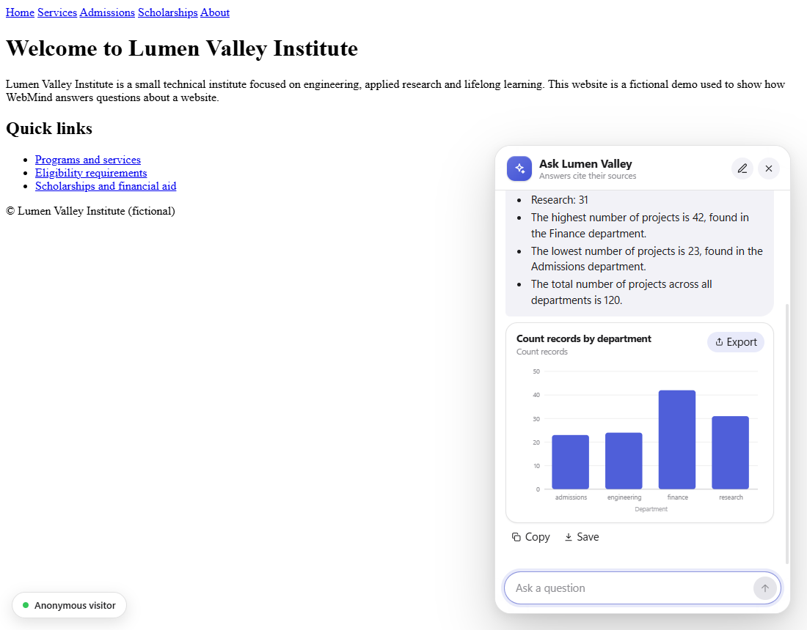
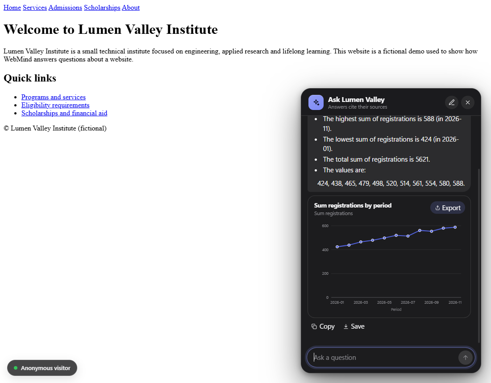
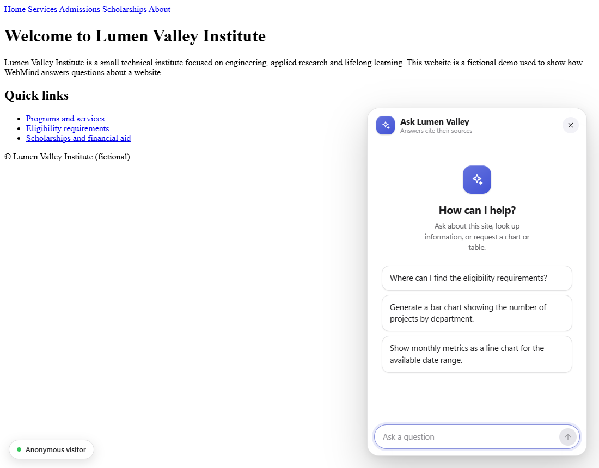
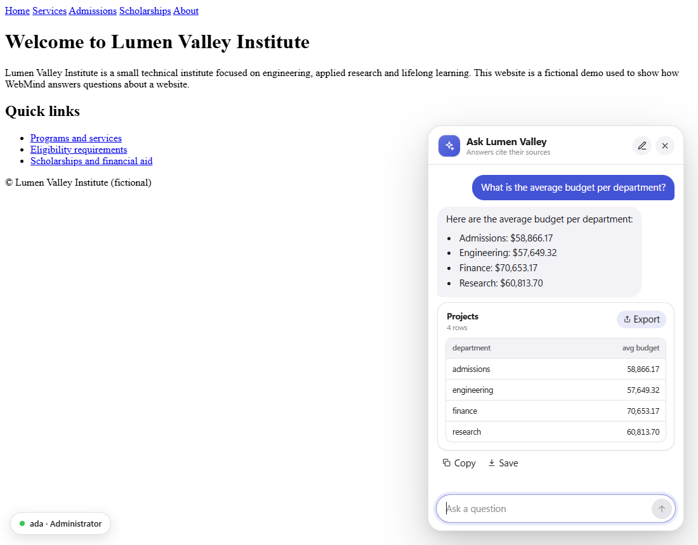
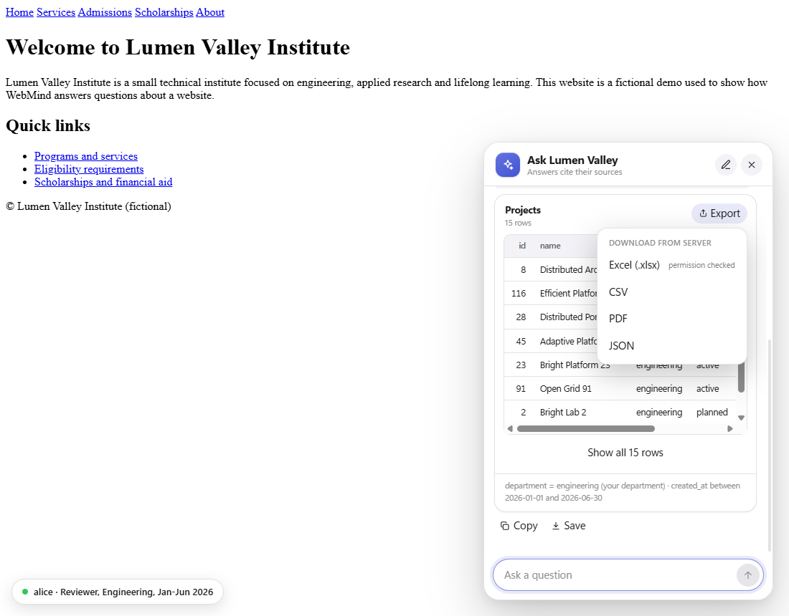
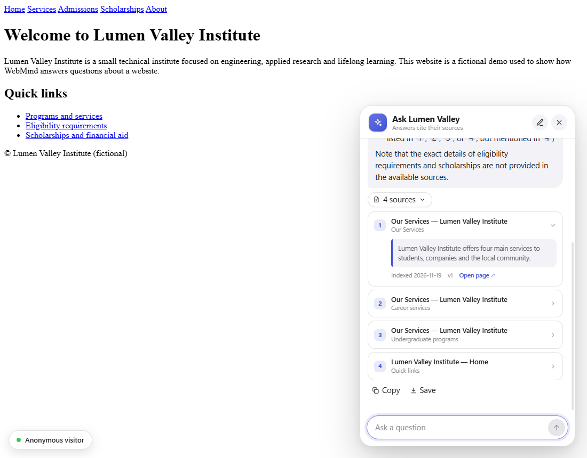
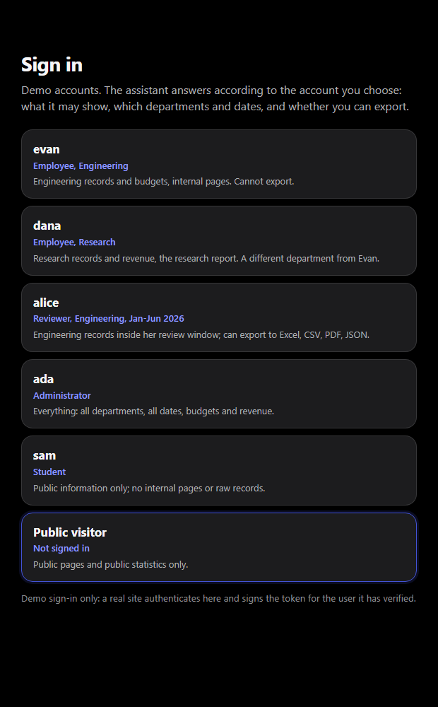
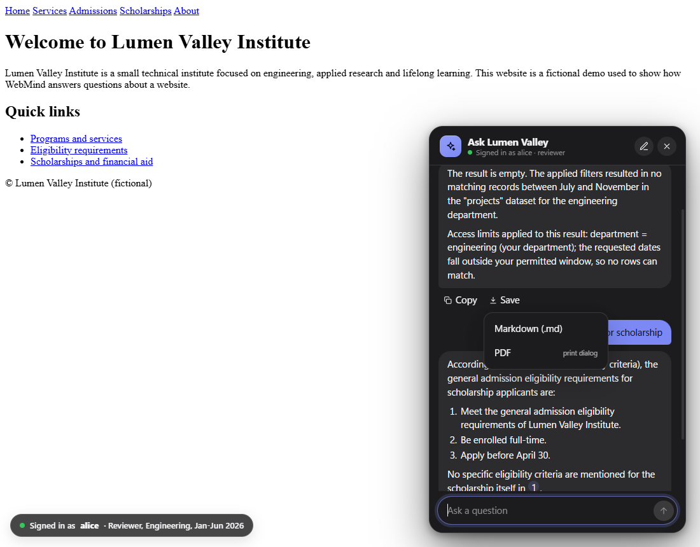

# Frontend: widget and React SDK

WebMind's assistant interface ships two ways that share **one core and one stylesheet**:

| Surface | Use it for | Source |
| --- | --- | --- |
| `<script src=".../v1/widget.js">` | any website, CMS, static site | generated into `src/webmind/api/static/webmind-widget.js` |
| `@webmind/react` | React / Next.js apps, custom UIs | `sdk/react/src` |

```
sdk/react/src/core/      richtext.ts   safe answer parser (never produces HTML)
                         chartgeom.ts  chart layout: scales, ticks, marks, tooltips anchors
                         exports.ts    CSV, JSON, XLSX (hand-written OOXML), SVG/PNG, Markdown, print, policy
                         icons.ts      icon shapes
sdk/react/src/webmind.css            the single stylesheet (tokens, light/dark, responsive)
sdk/react/src/*.tsx                  React components built on the core
sdk/react/widget/widget-ui.js        plain-DOM UI built on the same core
sdk/react/scripts/postbuild.mjs      assembles core + CSS + widget-ui into the one-file widget
```

`npm run build` regenerates the widget. `sdk/react/test/widget.test.mjs` fails if the committed bundle is stale,
so the two surfaces cannot drift.

## Look and feel

Understated and iOS-inspired: translucent blurred panel, 22px radius, system font stack (SF on Apple devices),
soft shadows, indigo accent, message bubbles, pill composer with a circular send button, cards for charts, tables
and files, spring-like transitions (disabled under `prefers-reduced-motion`). Light and dark follow the system
(`data-theme="auto"`) or can be forced. On screens up to 520px the panel becomes a bottom sheet.

| Desktop, light | Dark | Mobile |
| --- | --- | --- |
|  |  |  |

  


React components render with the same markup and CSS (`sdk/react/scripts/ssr-snapshot.mjs` renders them for
inspection): [light](images/react_light.png), [dark](images/react_dark.png).

## Embedding the script widget

```html
<script src="https://assistant.example.org/v1/widget.js"
        data-endpoint="https://assistant.example.org"
        data-token-url="/api/webmind-token"
        data-title="Ask Lumen Valley"
        data-suggestions="Where is the admissions page?|What does tuition cost?"
        defer></script>
```

| Attribute | Default | Meaning |
| --- | --- | --- |
| `data-endpoint` | script origin | WebMind server URL |
| `data-token-url` | none | Your endpoint returning `{"token": "..."}` for the signed-in user (cookies are sent) |
| `data-title` | "Ask this site" | Header title |
| `data-subtitle` | identity line | Replaces the identity line ("Signed in as alice · reviewer" / "Public visitor") |
| `data-login-url` | none | Where anonymous visitors sign in; shows a "Sign in" link in the header |
| `data-position` | `right` | `right` or `left` |
| `data-theme` | `auto` | `auto`, `light`, `dark` |
| `data-accent` | indigo | Accent color |
| `data-suggestions` | none | Up to 4 prompts separated by `\|` |
| `data-client-exports` | `aggregates` | `aggregates`, `all`, `off` |
| `data-streaming` | `true` | `false` to use single responses |
| `data-open` | `false` | `true` opens the panel on load |

**Your page must declare a viewport** (`<meta name="viewport" content="width=device-width, initial-scale=1">`).
Without it phones lay the page out at ~980px and shrink everything, including the assistant. The demo host app
adds the tag when serving; a real site should include it.

## Identity and menus

- Under the title the assistant shows the identity WebMind verified (`GET /v1/me`): **Signed in as alice · reviewer**, or
  **Public visitor** with an optional *Sign in* link (`data-login-url` / `loginUrl`). Answers always follow that identity.
- Popover menus (Export, Save) open below and left-aligned, flip upward near the bottom of the chat, align right near
  the right edge, and are raised above later messages, so they are never clipped or covered. Message actions stay
  reachable on touch screens (faint at rest, full on hover/focus/menu open).

 

## Exports and permissions

Everything exported client-side is already on screen: no extra data is fetched. By default only **aggregate**
results (statistics, charts) and the answer text can be exported in the browser. **Raw record tables** are
exported by the server (Excel, CSV, PDF, JSON) through the normal permission-checked `export` flow: the menu sends
a follow-up message ("Export these results into Excel."), and the result arrives as a download card. A user without
the `export` capability gets the usual denial, and the audit log records it.

`clientExports="all"` (React) / `data-client-exports="all"` lets users download any displayed table in the browser;
use it only when downloading what users can already see is acceptable for your data. `off` hides client-side
exports. Spreadsheet cells beginning with `= + - @` are neutralized in CSV and Excel.

## Security properties (tested)

- Answers, citations and cells are rendered as text nodes / React elements; markup in content stays inert.
- Links are restricted to `http(s)`; `javascript:`/`data:` never become links.
- The widget runs in a shadow root, stores nothing, and never sees secrets; the print/PDF report is fully escaped.
- The bundle contains no `innerHTML`, `eval` or imports (asserted in `widget.test.mjs`).

More states: [anonymous denial with a sign-in hint](images/ui_anon_signin_hint.png), [Save menu on a phone](images/ui_save_menu_mobile.png).
